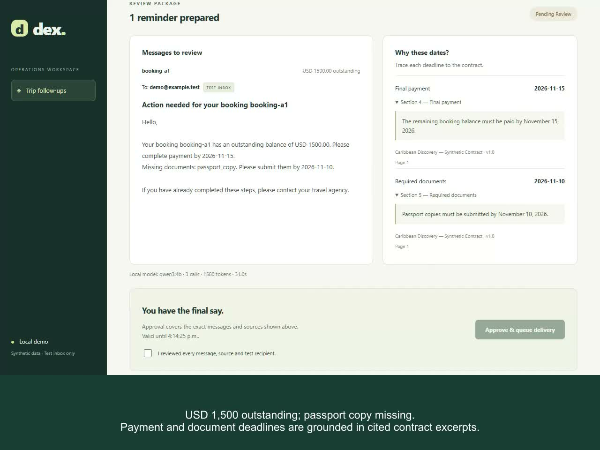

# Dex AI Operations Agent

A local portfolio demo of an approval-gated AI workflow for travel operations. Dex finds bookings with both an unpaid balance and missing documents, retrieves contract evidence, and prepares reminders for a human to review. Approved messages go only to a local Mailpit inbox. All data is fictional.

## The project in 30 seconds

**Problem:** prepare travel reminders from unpaid bookings, missing documents and cited contract deadlines, with human approval before delivery.

**Architecture:** React → TypeScript/Fastify + local Qwen3 → scoped tools → PostgreSQL/pgvector → approval → worker → test inbox. Every admitted run has a correlated trace. Fictional data; independent of GroupDeck.

**Evidence:** 98 passing tests include 60 system scenarios. Separately: 8/8 live-model cases and 4/4 adversarial cases. [Dated results and limits](docs/eval-results/latest.md).

**Run:** install Node 24 and Docker, follow the [local commands](#run-locally), then open localhost:3000. Setup defaults to a labeled scripted planner; [enable Qwen](#enable-the-real-local-model) for real model decisions.

[Two-minute demo](docs/demo-video.md) · [CI workflow](.github/workflows/ci.yml) · [Latest evaluation evidence](docs/eval-results/latest.md)

[](docs/demo/dex-demo.mp4)

## See the workflow

1. Enter the demo workspace and prepare the default request.
2. Review the USD 1,500 balance, payment deadline of November 15, 2026, and document deadline of November 10, 2026, with cited contract excerpts.
3. Confirm the review and approve delivery. The worker sends to demo@example.test.
4. Inspect Mailpit and expand Run history for tool activity, duration and token usage.

[Five-minute demo script](docs/demo-script.md) · [Architecture diagram](docs/architecture.md) · [Interview guide](docs/interview-guide.md)

[Dex capability provenance](docs/dex-capability-map.md) · [60-case evaluation matrix](docs/evaluations.md) · [End-to-end tracing](docs/tracing.md)

## Run locally

Requires Node.js 24, npm and Docker Compose v2. Use a separate checkout; this project does not connect to GroupDeck. Ports 3000, 5432, 1025 and 8025 must be available; optional Ollama uses 11434.

```sh
npm ci
npm run setup:demo
docker compose up -d --wait
npm run build
node --env-file=.env scripts/index-contracts.mjs
npm run dev
```

In a second terminal:

```sh
npm run worker
```

Open [Dex](http://localhost:3000/) and [Mailpit](http://localhost:8025/). In PowerShell, use npm.cmd if execution policy blocks npm.ps1.

The setup command creates an ignored .env with a random token and preserves any existing .env. The default LLM_MODE=mock is explicitly labeled **Scripted demo**. The first index operation downloads MiniLM weights; later runs reuse .cache/models. The migration-role URL in .env is a disposable local credential for indexing, separate from the restricted API role.

Fresh Docker volumes apply migrations 001–007 automatically. Existing volumes do not rerun initialization: apply only missing migrations in order using the migration role. See [setup and troubleshooting](docs/local-demo.md) and [trace migration](docs/tracing.md#local-migration). Never delete an existing volume to migrate it.

## Enable the real local model

```sh
docker compose --profile llm up -d ollama
docker compose exec ollama ollama pull qwen3:4b
```

Set LLM_MODE=ollama and OLLAMA_MODEL=qwen3:4b in .env, then restart the API. The model download is about 2.5 GB and the container has a 4 GB memory limit; the host also needs headroom for PostgreSQL and the app. The model uses CPU on this configuration. Measured draft preparation varied from roughly 13 to 34 seconds locally; this is not a performance guarantee. [Model setup and boundaries](docs/local-llm.md).

## What is implemented

| Area | Current behavior |
| --- | --- |
| UI and API | React/Vite, TypeScript/Fastify; local demo session |
| Authorization | PostgreSQL RLS for agency membership, group assignment and draft/run creator |
| Retrieval | Local MiniLM embeddings, pgvector similarity and text ranking with cited sources |
| Agent | Qwen3 4B proposes schema-constrained tool calls; the server validates order and arguments |
| Drafting | Integer money, strict synthetic deadline grammar, deterministic English message template |
| Approval | Exact payload hash, expiry, current data and permission checks |
| Background delivery | Transactional PostgreSQL queue, separate worker, fixed Mailpit destination |
| Visibility and limits | Scoped persistent trace events, model/tool/approval/worker correlation, last 20 run summaries, usage metrics and per-run limits |

The model chooses permitted tools and a search query. It does not execute SQL, grant access, approve messages or invent financial values. This is a bounded workflow, not general contract interpretation.

## Verification

```sh
npm test
npm run eval:matrix
npm run test:security
npm run eval:model-matrix
npm run eval:llm
npm run eval:adversarial
npm run report:evals
```

npm test includes deterministic and PGlite checks; service-dependent cases require environment flags. Before test:security, stop the demo worker and finish any queued/sending jobs. That command enables all local integration checks and writes JSON/JUnit evidence. Restart the worker afterwards. The LLM evaluation commands require Ollama; they never approve or send messages.

Recorded results on October 4, 2026: **60/60 matrix scenarios**, **8/8 selected cases using the live local model**, and **98 passing JUnit test cases with zero skips** in the full local-service suite. The 60 matrix cases are included in that test suite, not added to its total. Node also counts two parent tests (100 entries). Prior 18/18 normal/refusal and 4/4 adversarial model reports remain dated evidence. Fixture proposals do not measure LLM selection accuracy; each report explains its execution layer. These synthetic suites are regression evidence, not proof of universal accuracy or security. [Results and limitations](docs/evaluations.md).

## Continuous verification

The Actions workflow runs the 98-case local integration/security suite and 60-case matrix on every push/PR, with JSON/JUnit artifacts and a readable job summary. Live Qwen and adversarial evals run weekly or on manual dispatch. Old results are discarded before each job so a failed run cannot present stale evidence as a fresh pass. The workflow is configured locally; a hosted run requires pushing this independent repository to GitHub. It does not deploy infrastructure.

npm run report:evals generates docs/eval-results/latest.md and preserves a dated snapshot keyed by evidence hashes. Each layer retains its actual evaluation date and model identity.

## Repository map

- src/: API, bounded agent, tools, authorization, approvals and worker.
- web/: English review workspace and run history.
- database/: numbered schema, fixtures, roles and RLS migrations.
- fixtures/, tests/, scripts/: reproducible examples, test suites and evaluations.
- docs/: architecture, demo, decisions and recorded evidence.

## Scope and publication status

No paid inference, AWS infrastructure or GroupDeck integration is deployed. Production authentication, arbitrary PDF ingestion, global cost reservations, durable model-job scheduling and CDK implementation are future work. SMTP uncertainty requires inspection rather than automatic retry. Model runs still execute within the API request; only delivery has a durable job queue.

The author has deliberately chosen to publish without a redistribution license. No permission to reuse the original project code is granted. Third-party dependencies and models retain their own licenses; see [third-party notices](docs/third-party-notices.md) and the [publication checklist](docs/publication-checklist.md).
