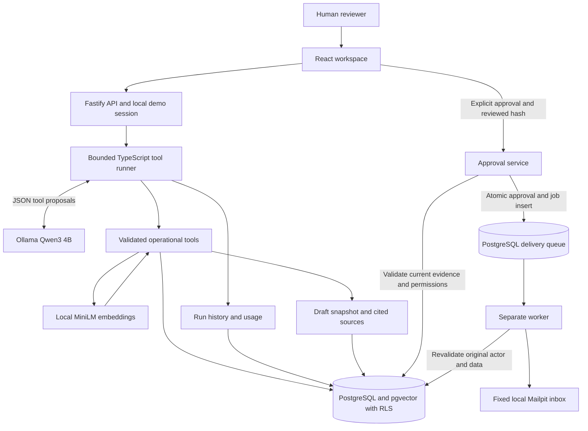

# Architecture

Dex is a bounded travel-operations workflow with a local LLM, evidence retrieval, a human approval boundary and a durable delivery queue. Everything shown below is implemented locally. AWS/CDK and GroupDeck integration remain future work.

## One request through the system

The server derives user and agency identity from the local demo authenticator. The runtime database role is not an owner and has no BYPASSRLS. Transaction-local identity settings activate membership, group-assignment and creator policies. A model-provided agency identifier cannot change this scope.

The model proposes one of the next permitted workflow tools or stop. Zod supplies the constrained response schema and validates the proposal again on the server. Tools find bookings requiring both payment and documents, search contract sources, and prepare a draft. Tools cannot approve or send. Repeated and out-of-order calls are rejected.

SQL determines balances in integer minor units. MiniLM produces 384-dimensional vectors; pgvector similarity and PostgreSQL text ranking return relevant authorized clauses. The runner expands the small evidence set with all active authorized clauses so that top-k retrieval cannot hide a contradictory deadline. Dates are resolved with a strict synthetic grammar. The final English message uses a deterministic template.

The saved draft contains message text, fixed recipient and source evidence, with a 30-minute expiry. Human approval binds the exact canonical payload hash. Approval and job insertion are atomic and idempotent per draft. The worker claims a job with SKIP LOCKED and rechecks permissions, balances, documents, evidence and expiry before SMTP delivery.

## Boundaries worth defending in an interview

| Boundary | Enforcement | Limitation |
| --- | --- | --- |
| Agency and group | PostgreSQL RLS plus server-derived identity | Local demo auth is not production authentication |
| Model to tools | Stage-specific schema and server validation | Correct JSON does not guarantee correct intent |
| Evidence to draft | Source provenance and conflict-aware date validation | Only supported synthetic wording is parsed |
| Review to delivery | Payload hash, expiry, current-state validation | An external SMTP send cannot share the database transaction |
| Delivery recovery | Unique job per draft; uncertain outcomes not retried | Operator reconciliation is required after ambiguous acceptance |
| Inference usage | Call, token, time, context and per-process concurrency limits | No aggregate paid-provider budget reservation |

## Persistence and recovery

Agent runs are recorded before inference and finalized with completed tool timings, usage and a safe error category. History exposes only the creator's latest 20 authorized runs. It does not store raw prompts or provider responses. A process crash or lost permission can leave a run unfinished; there is no automatic agent-run reconciler yet. Model work happens in the API request, not in a durable inference queue.

Only delivery runs as a durable background job. The worker role can access the queue, while business validation uses the restricted runtime role and original actor. A stale sending claim or an ambiguous SMTP result becomes uncertain, without automatic resend. Revocation can still race with external acceptance after the final database check; this implementation does not claim exactly-once delivery.

## Code map

| Concern | Files |
| --- | --- |
| Identity and web sessions | src/auth.ts, src/web.ts |
| Workflow and model adapter | src/agent.ts, src/ollama.ts |
| Scoped tools and evidence | src/store.ts, src/embeddings.ts, src/contracts.ts |
| Approval and delivery | src/approval.ts, src/delivery.ts, src/worker.ts |
| Schema and policies | database/001-foundation.sql through 007-tracing.sql |
| Review and activity | web/main.tsx, web/RunHistory.tsx |
| Verification | tests/, scripts/eval-llm.mjs, scripts/eval-adversarial.mjs |

## Future architecture

A future AWS design could use ECS for API/worker, RDS PostgreSQL with pgvector, S3 for documents, Secrets Manager and CloudWatch. This is a design direction, not implemented or deployed CDK. Costs, production identity, document lifecycle and extension compatibility require separate work.

A future GroupDeck adapter would implement the operational data boundary without transferring authority to the model. The present OperationsStore interface and fictional PostgreSQL data are the starting point; no live GroupDeck data or credentials are used.
